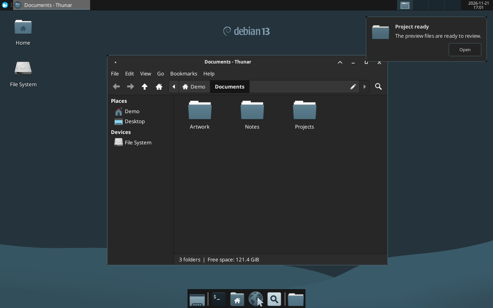

# Ceratopsian Dark Theme for Xfce

Ceratopsian brings the graphite and muted blue-grey of the modified Debian 13 wallpaper to the Xfce desktop. It includes window borders, compact GTK controls, the Xfce window switcher and lock dialog, notifications, icons, cursors and an Xfce Terminal palette.



[Thunar](previews/thunar.png) · [Whisker menu](previews/whisker.png)

[Wallpaper preview](previews/wallpapers.jpg) · [Artwork credits](BRANDS.md)

## Install on Debian 13

Ceratopsian targets Xfce 4.20 on Debian 13, with styles for GTK 2, GTK 3.24 and GTK 4.18. Download the [Debian package](https://github.com/gagafes/ceratopsian-xfce/releases/latest) and install it from the download directory.

```sh
sudo apt install ./ceratopsian-xfce_0.1.0-1_all.deb
```

Choose Ceratopsian in Xfce after installing.

| Xfce settings | Theme |
| --- | --- |
| Appearance → Style | Ceratopsian Dark |
| Appearance → Icons | Ceratopsian |
| Window Manager → Style | Ceratopsian-Dark |
| Notifications → Theme | Ceratopsian-Dark |
| Mouse and Touchpad → Theme | Ceratopsian Cursors or Ceratopsian Cursors Light |

In **Desktop Settings**, choose Debian 13 Matte in `/usr/share/backgrounds/ceratopsian-xfce` or Clean in `/usr/share/backgrounds/ceratopsian-variants`. In **Xfce Terminal → Edit → Preferences → Colors**, choose the **Ceratopsian** preset.

The Debian package puts the GTK and icon themes in the system directories so administrator-launched applications such as Synaptic can use them. [Optional boot and greeter instructions](extras/README.md)

## Install for one user

The source archive also includes an installer for one user. Run it from your Xfce session as your desktop user with Python 3.11 or newer and `xfconf-query`.

```sh
python3 install.py install
```

The installer selects Ceratopsian for GTK, Xfwm, notifications, icons and cursors. Use `--keep-icons` to retain your icon and cursor selections or `--assets-only` to copy the files for manual selection in Xfce Settings.

In **Settings → Desktop**, choose **Debian 13 Ceratopsian Matte** in `backgrounds/ceratopsian-xfce` or **Clean** in `backgrounds/ceratopsian-variants` inside your XDG data directory, usually `~/.local/share`. Use `--wallpaper` for the Debian 13 artwork or `--wallpaper clean` for Clean to apply the choice to workspaces with configured wallpapers.

Select **Ceratopsian Cursors Light** in **Mouse and Touchpad → Theme** or use `--cursor light` when installing. The light set uses a `#91ADBA` face with a graphite outline.

In **Xfce Terminal → Edit → Preferences → Colors**, select the **Ceratopsian** preset. The GTK 2 compatibility layer uses your distribution's GTK 2 pixbuf and Murrine engines.

## Uninstall

For the Debian package, select your next theme in Xfce and run `sudo apt remove ceratopsian-xfce`.

For the per-user installation, run the original installer with `uninstall`.

```sh
python3 install.py uninstall
```

The installer records its changes in `ceratopsian-xfce` inside your XDG state directory, usually `~/.local/state`. Uninstall restores the previous Xfce theme settings and preserves later selections, local file edits and matching files that were already present. You can reverse changes made in the graphical desktop and terminal settings in those same settings.

## Build a Debian package

Install `build-essential`, `debhelper` and `dpkg-dev` on Debian 13, then run this from the checkout.

```sh
dpkg-buildpackage -us -uc -b
```

The build writes the `all` package to the checkout's parent directory. See [asset sources](SOURCES.md) for the inherited material and render recipes.

## Components

- `themes/Ceratopsian-Dark` contains GTK 2, GTK 3, GTK 4, Xfwm and xfce4-notifyd. The panel, lock dialog and notifications share colours through `gtk-3.0/ceratopsian-palette.css`.
- `icons` contains icon and cursor themes. Panel and Whisker settings use the standard Xfce icon lookup.
- `wallpapers` contains the edited SVG and a PNG rendering.
- `wallpaper-variants` contains the Clean desktop SVG and the PNG shared with Plymouth. The GRUB background has its own dimensions.
- `extras` contains [Qt, Synaptic, LightDM and boot integration instructions](extras/README.md).

See [credits](CREDITS.md) and [licences](LICENSE.md) for the upstream projects used in this build.
